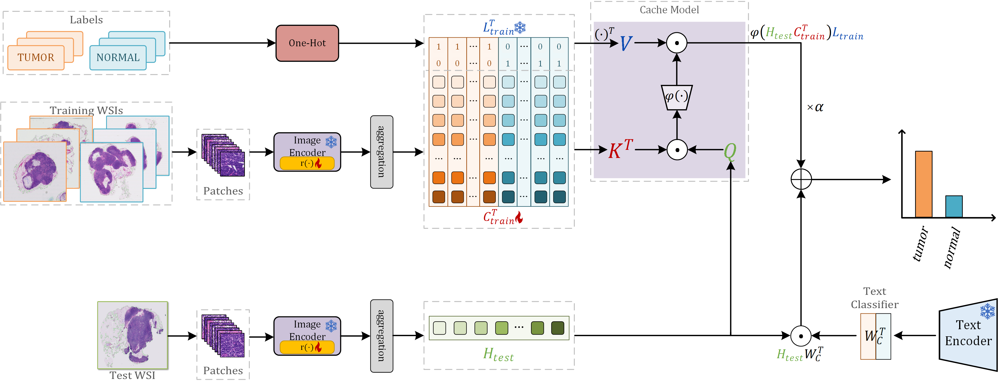

# BiCa-MIL

**BiCa-MIL: Bidirectional Co-adaption Multiple Instance Learning for Enhanced Whole Slide Image Analysis**

Official implementation of **BiCa-MIL**, a weakly supervised multiple instance learning framework for whole slide
image (WSI) analysis based on PLIP. The framework supports cancer diagnosis, subtyping and survival prediction,
under both full-data and few-shot settings, without task-specific fine-tuning of the PLIP backbone.



---

## Environment

```bash
pip install -r requirements.txt

# additionally required by the code:
pip install transformers scikit-learn scikit-survival openTSNE matplotlib shapely tqdm opencv-python seaborn
```

The PLIP checkpoint should be downloaded from Hugging Face and passed to every run through `--plip_model_path`.

## Data preparation

Prepare one `*.pt` file per WSI, containing the patch features extracted by the frozen PLIP image encoder:

```python
torch.save({'features': features, 'labels': label}, 'slide_name.pt')
# features: FloatTensor [num_patches, 512]
# labels  : int (0/1 for classification, the discretized bin index for survival)
```

Dataset layouts expected by `--dataset_root`:

| `--datasets` | Layout | Task |
|--------------|--------|------|
| `camelyon16` | `train_and_val/*.pt` and `test/*.pt` | metastasis classification |
| `tcga-brca` | a flat directory of `*.pt` (split in code) | subtyping |
| `tcga-blca` | a flat directory of `*.pt` plus `BLCA_Splits.csv` (`Study, ID, Event, Status, WSI`) | survival prediction |

## Usage

**BiCa-MIL on Camelyon16:**

```bash
python main.py --datasets=camelyon16 --dataset_root=/path/to/features \
    --model=adapter_mil --fewshot_samples=-1 --n_classes=2 \
    --seed=2024 --epochs=100 --patients=30 --lr=1e-4 \
    --init_alpha=1 --init_beta=1 \
    --plip_model_path=/path/to/plip --save_path=/path/to/save/models
```

**TCGA-BRCA subtyping:**

```bash
python main.py --datasets=tcga-brca --dataset_root=/path/to/features --model=adapter_mil ...
```

**TCGA-BLCA survival prediction:**

```bash
python main.py --datasets=tcga-blca --dataset_root=/path/to/features \
    --model=adapter_mil --n_classes=4 --patients=20 ...
```

**Few-shot setting:** add `--fewshot_samples=N` (per class for Camelyon16, patients for TCGA-BLCA; `-1` uses all
training data).

**Baselines and ablations:** change `--model` to `ab_mil` (AB-MIL), `rrt_mil` (R²T-MIL) or `text_mil`
(BiCa-MIL without the cache model).

`run.bat` is an example Windows launcher — edit the paths at the top before running.

### Main arguments

| Argument | Default | Description |
|----------|---------|-------------|
| `--datasets` | `camelyon16` | `camelyon16` \| `tcga-brca` \| `tcga-blca` |
| `--dataset_root` | – | directory of the `*.pt` feature files |
| `--model` | `ab_mil` | `ab_mil` \| `rrt_mil` \| `adapter_mil` \| `text_mil` |
| `--fewshot_samples` | `-1` | few-shot sample count; `-1` = full training data |
| `--n_classes` | `2` | use `4` for survival analysis |
| `--epochs` / `--patients` | `100` / `30` | max epochs / early-stopping patience (`20` for TCGA) |
| `--lr` | `1e-4` | Adam learning rate |
| `--seed` | `2024` | random seed |
| `--input_dim` | `512` | patch feature dimension |
| `--val_ratio` / `--test_ratio` | `0.33` / `0.33` | validation / test ratio |
| `--init_alpha` / `--init_beta` | `1.0` / `1.0` | scale and sharpness of the cache model |
| `--plip_model_path` | – | local directory of the PLIP checkpoint |
| `--save_path` | – | directory for the saved checkpoints |

### Outputs

Classification runs print Accuracy / AUC / F1 / Precision / Recall / Specificity / NPV on the test set; survival
runs print the test C-index. The best checkpoint (selected on validation performance) is saved to `--save_path`
as a complete model file and can be reloaded with `torch.load`.

## Visualization

`visualization.py` exports per-patch features with a trained model and draws a t-SNE coloured by the tumor/normal
annotations of each slide (edit the paths at the bottom of the file before running):

```bash
python visualization.py
```

`other_codes/` additionally provides attention/CAM heatmap scripts for the WSI, and `figures.ipynb` regenerates
the figures of the paper.

## Pre-trained checkpoints

`ablation_models/` contains pre-trained BiCa-MIL checkpoints for Camelyon16 and TCGA-BRCA, loadable directly with
`torch.load`.

## Citation

```bibtex
@article{zhao2025bicamil,
  title   = {BiCa-MIL: Bidirectional Co-adaption Multiple Instance Learning for Enhanced Whole Slide Image Analysis},
  author  = {Zhao, Enbo and Li, Yushuang},
  journal = {TechRxiv},
  year    = {2025},
  doi     = {10.36227/techrxiv.175355298.85276672/v1}
}
```

## Acknowledgements

This code builds on [PLIP](https://github.com/Path-AI/PLIP) for pathology vision–language pre-training,
[Tip-Adapter](https://github.com/gaopengcuhk/Tip-Adapter) for the cache-model formulation, and the
[R²T-MIL](https://github.com/DearCaat/RRT-MIL) code base for the region-based encoder and the TCGA-BLCA data split.
